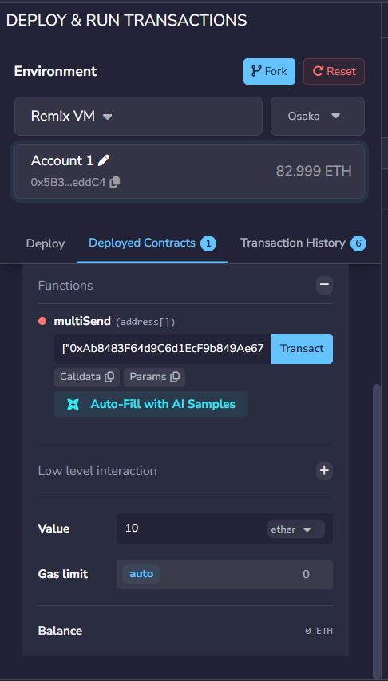
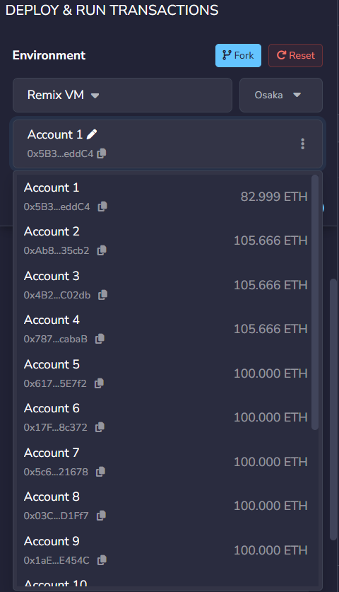
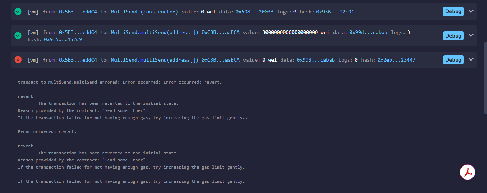
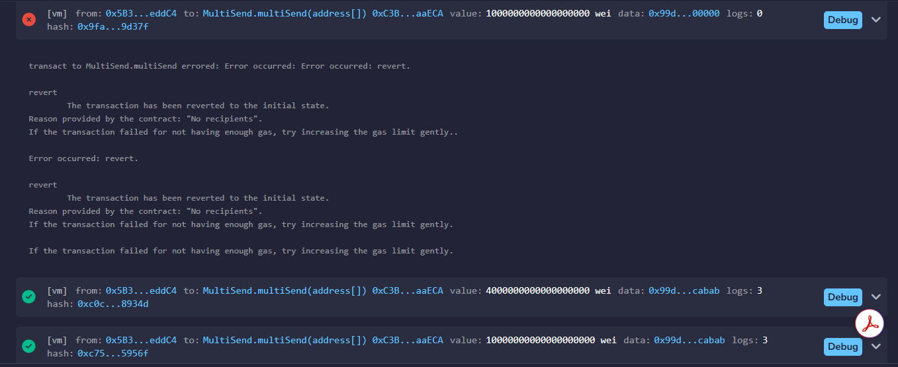

# CodeAlpha_MultiSend

Task 2 of the CodeAlpha Blockchain Development Internship.

## What it does
A Solidity smart contract that splits one Ether payment equally among a list of addresses.
- `multiSend(address[] recipients)`: payable function that receives Ether and sends an equal share to each recipient using a loop
- Every transfer is checked, and the whole transaction reverts if any one fails
- Leftover wei from integer division is refunded to the sender
- `Sent` event is emitted for every payment

## How to run (Remix IDE)
1. Open https://remix.ethereum.org
2. Create `MultiSend.sol` and paste the code from `/contracts`
3. Compile with Solidity 0.8.20 or newer
4. Deploy using the Remix VM environment
5. Copy three recipient addresses from the account dropdown (not the sender)
6. Set Value (e.g. 3 ether), enter `["0xAddr1...","0xAddr2...","0xAddr3..."]` in `multiSend`, and click Transact

## Test results
| Action | Expected | Result |
|---|---|---|
| Send 3 ETH to 3 addresses | 1 ETH each | Pass |
| Send 0 wei | Revert: "Send some Ether" | Pass |
| Send 1 ETH to empty list `[]` | Revert: "No recipients" | Pass |
| Send 4 ETH to 3 addresses | 1.333 ETH each, remainder refunded | Pass |
| Send 10 ETH to 3 addresses | 3.333 ETH each, remainder refunded | Pass |

Final balances after 17 ETH sent in total: each recipient 105.666 ETH, sender 82.999 ETH (includes gas).

## Screenshots

## Concepts demonstrated
Payable functions, `msg.value`, address arrays, loops, sending Ether with `.call`, checking transfer success, handling rounding remainders, `require()` validation, events.
